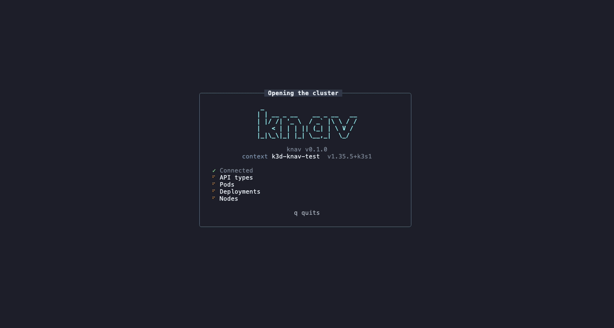
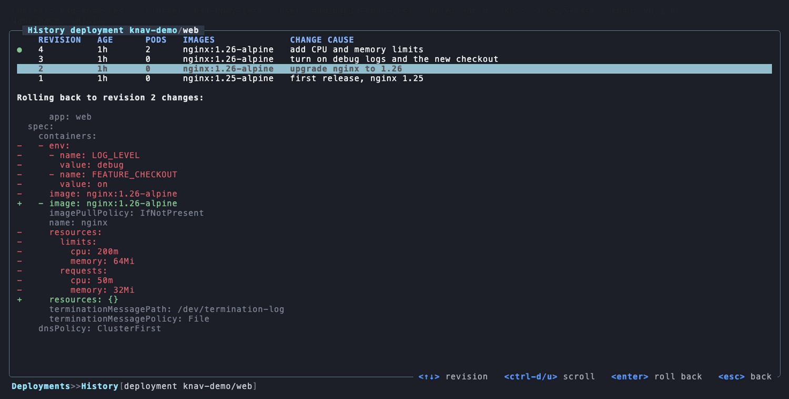
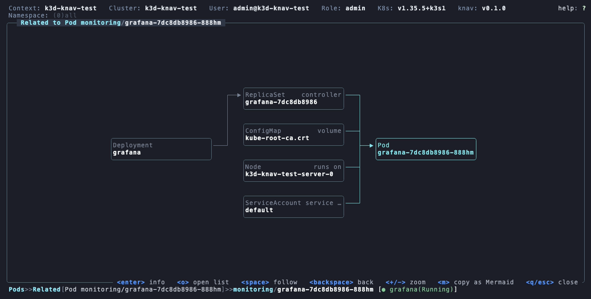
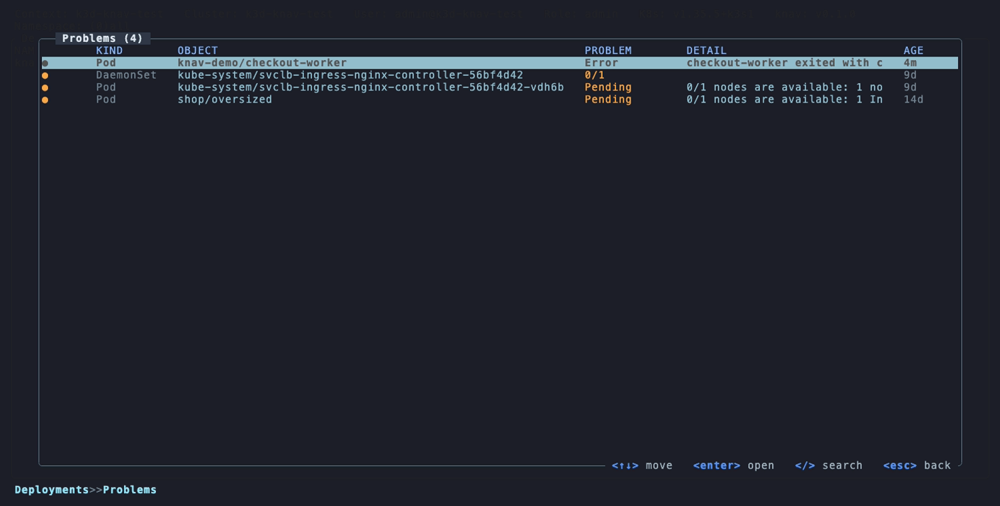
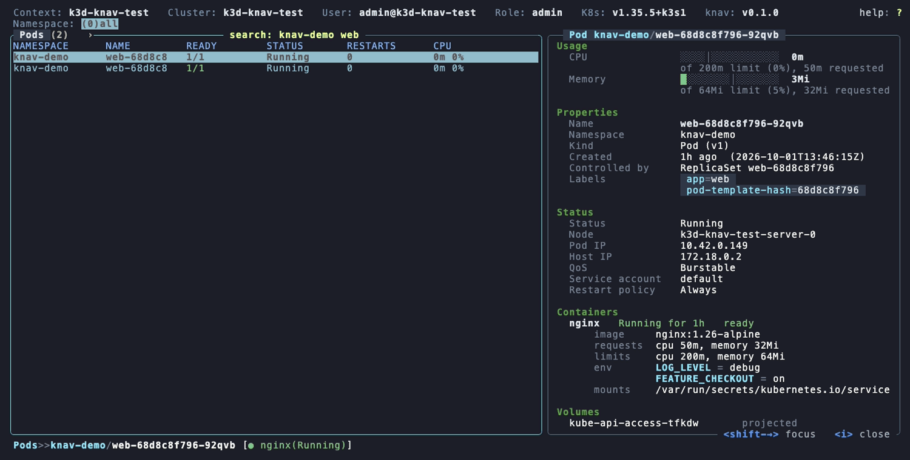
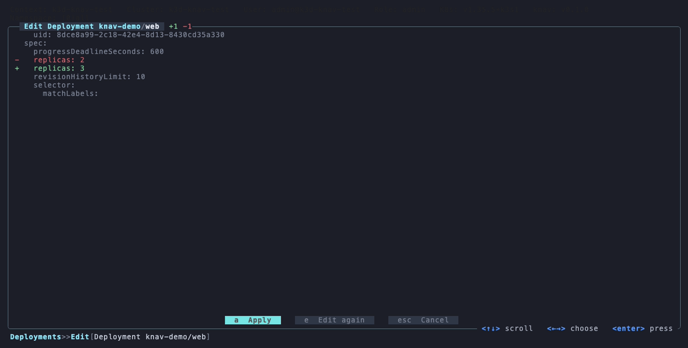
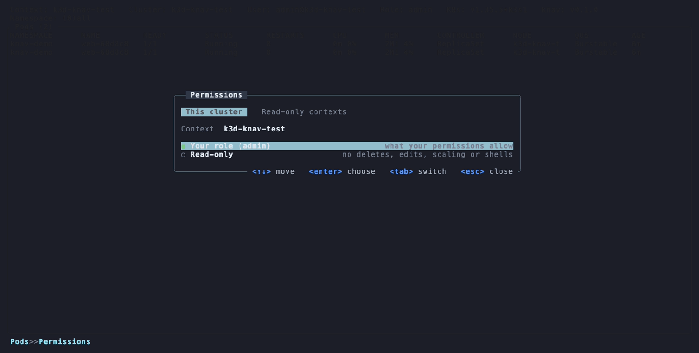

# knav

A high performance, mouse-friendly TUI to explore and debug Kubernetes clusters,
built in Rust. Think k9s with an IDE's explorer.



- **Sidebar** of every kind, custom resources included, with live counts.
- **Info panel** (`i`) explains the selected object: status, containers, events.
- **Relations diagram** (`R`) shows what an object depends on and what depends on it.
- **Extensions** (`E`) add views and dashboards for Flux, Argo CD, cert-manager and more. Read-only.
- **Problems** (`!`) lists everything that needs a look across the cluster, with the reason.
- **CPU and memory** per pod, against its limits.
- **Rollout history** (`v`) compares the revisions of a Deployment, StatefulSet or DaemonSet and rolls back.
- **Your own commands** on any key: `kubectl describe`, `stern`, anything with the selected object filled in.
- **Debug containers** (`X`) for pods without a shell, and logs saved to a file with `w`.
- **Knows your access**: the header shows your role (admin, read-write, read-only), checked against RBAC.
- **Built for scale**: stays fast with tens of thousands of objects.

## Take a look

### Rollout history (`v`)

Every revision a Deployment still has, with its images and change cause. Pick one to
see exactly what rolling back to it would change, then roll back with Enter. Here,
going back to revision 2 drops the debug env vars and the limits added since.



### Related objects (`R`)

The objects around the selected one: its controller and owner, the ConfigMaps and
Secrets it mounts, its node and service account. Move between boxes, open any of
them, or follow one to see what surrounds it next.



### Problems (`!`)

Everything that needs a look, across the cluster, worst first, each with the reason in
a word and the cluster's own explanation: why a container crashed, why a pod can't be
scheduled, which rollout is stuck. Enter jumps to it.



### Info panel (`i`)

What the selected object is doing, beside the list: usage against its requests and
limits, status, containers with their env and mounts, conditions and recent events.



### Review before applying an edit (`e`)

Edit in your `$EDITOR`, then see the change before it reaches the cluster: apply it,
edit again, or cancel. If the cluster refuses it, the reason shows on top and your
edit is kept.



### Permissions (`P`)

Per cluster, work with your own role or switch to read-only, which blocks deletes,
edits, scaling and shells. More tabs list the contexts that are always read-only, and
the ones whose header turns red so you notice where you are, by name or pattern like
`prod*`.



## Install

```
curl -fsSL https://raw.githubusercontent.com/guilhermemcandido/knav/main/install.sh | sh
```

Or from source (Rust 1.96+):

```
cargo install --git https://github.com/guilhermemcandido/knav
```

Needs a kubeconfig. `kubectl` is used for port-forwards, shells, debug containers and your own commands.

## Use

```
knav              # current context
knav -c prod      # pick a context by name
knav --read-only  # block every change: delete, edit, scale, shells (the P menu can't lift it)
knav -c           # pick a context from a list
knav update       # update to the latest release (-y skips the question)
```

`knav update` downloads the latest release and checks its checksum before replacing the binary. GitHub limits anonymous requests, so set `GITHUB_TOKEN` (or `GH_TOKEN`) if it says it is being rate limited. A build from Homebrew or Nix is updated by that tool. It never installs an older version.

Port-forwards still work in read-only mode: they change nothing in the cluster, but they do open a local port, so check the address.

Press `?` anywhere for the keys on that screen. The essentials:

| Key | Does |
| --- | --- |
| `:pods` | open any resource (`:svc`, a custom resource, ...). Matches the text as typed, in one piece, like `/` (`:=pods` is exactly that name). Narrow it with filters that stack, like a GitHub search: `:agents group:kagent`, `ext:flux`, `is:custom` or `is:builtin` |
| `/` | search the list |
| `Enter` | drill in, from a Deployment down to a container's logs |
| `i` / `R` | info panel / related objects |
| `y` / `e` / `D` | YAML / edit / delete |
| `l` / `L` | a pod's logs / a whole workload's |
| `0`-`9` | switch to a reserved namespace |
| `!` | problems across the cluster |
| `v` | rollout history of a workload |
| `X` | a debug container in a pod |
| `P` | permissions: your role or read-only |
| `Space` | mark a row; `D`, `S` and `r` then act on every marked row |
| `Esc` | clear marks, then the filter, then go back |
| `ctrl-z` / `ctrl-w` | faults only / wide columns |
| `[` / `]` | the view before / after this one |
| `b` | sidebar |
| drag with the mouse | select text; it is copied when you let go |

### Home

Home shows every category of kinds, or only your favorites.

- `*` pins the selected kind (on Home, or in any list) and unpins it again.
- `f` switches between the favorites and every kind for this session. Settings picks which one Home opens on.
- Favorites sit in one box, three to a column. Pinned kinds a cluster lacks stay there, greyed.
- `Space` picks up a favorite, a category or a kind to move it: the arrows carry it and `Enter` drops it. You can also drag it with the mouse, and `[` / `]` nudge a favorite.

Favorites are saved as `home.favorites` and the order of categories and kinds under `[overview]`, both in `config.toml`.

## Config

Everything is set from the Settings screen (`,`) and saved to
`~/.config/knav/config.toml`, which you can also edit by hand:

- **General**: wide or faults-only lists on start, log order and timestamps, mouse, refresh rates
- **Appearance**: theme, box lines, icons (turn them off if your terminal can't draw images)
- **Behaviour**: start in the current context or a picker, read-only, port-forwards
- **Keys**: rebind any key
- **Layout**: which sections and tiles Home shows, and in what order
- **Home** (under General): whether Home opens on your favorites or every kind, and the favorites list

The namespaces you put on the `1`-`9` keys are saved there too, per context, under `[namespaces]`.

### Your own commands

Add them to `~/.config/knav/config.toml` (there is no Settings screen for these yet),
then restart knav. Each one runs on the selected object, from its key or by name on the
`:` line (`:describe`). `{kind}`, `{name}`, `{namespace}` and `{context}` are filled in
from the selection. Every command also gets `$KNAV_CONTEXT`, `$KNAV_NAMESPACE`, `$KNAV_KIND`
and `$KNAV_NAME` in its environment. **Always pass `--context {context}`** (or
`--context "$KNAV_CONTEXT"`) to `kubectl`: without it, kubectl uses the kubeconfig's own
current context, which may not be the cluster knav is showing. The placeholders are
quoted for you, so don't put quotes around them.

```toml
[[commands]]
name = "describe"
key = "ctrl-k"
read_only = true          # allowed in read-only mode
run = "kubectl describe {kind} {name} -n {namespace} --context {context}"

[[commands]]
name = "tail"
kinds = ["Deployment"]
output = "terminal"       # hand over the terminal; "view" shows the output, "background" a notice
run = "stern {name} -n {namespace} --context {context}"
```

Themes also switch live with `T`.

### Extensions

Extensions add views and dashboards for Flux, Argo CD, cert-manager, Istio and more (`E` lists them).
Each is a manifest, bundled or yours in `~/.config/knav/extensions/<id>/manifest.toml`: it lists the
kinds it covers and, optionally, dashboard widgets that draw as cards:

| `widget` | Shows |
| --- | --- |
| `count` | how many objects |
| `tally` | ready / failing / unknown by `ready`, `condition:<Type>` or `field:<.path>`; `suspend = ".spec.suspend"` counts suspended objects apart |
| `breakdown` | counts by a field's value, each value with a colour (`by`, `values = [["Synced", "ok"], ...]`, optional `default` for objects without the field) |
| `sum` | totals of numeric fields |
| `list` | a table of fields, optionally sorted, with date columns |

Several extensions that share a `category` share one dashboard (Flux and Argo CD under GitOps). The id
of an extension must be unique: a second one with the same id is refused. A dashboard can also be a
sandboxed WASM component (see `examples/`).

### The terminal title

While knav runs, the terminal's title reads `knav · <context> · <namespace>` and is put back when you quit.
If your shell prompt shows the Kubernetes context only for some commands (powerlevel10k, starship), add `knav`
to that list; it shows the kubeconfig's current context, not one you switched to inside knav.

## License

MIT or Apache-2.0.
